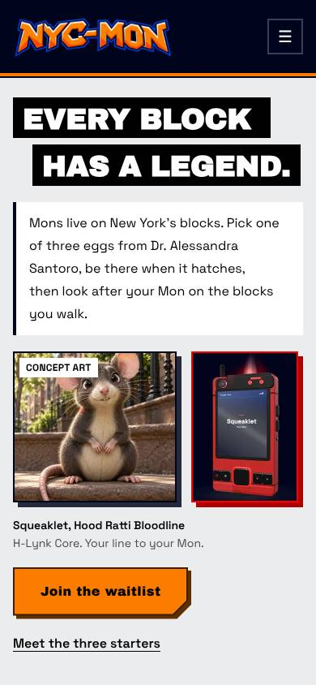
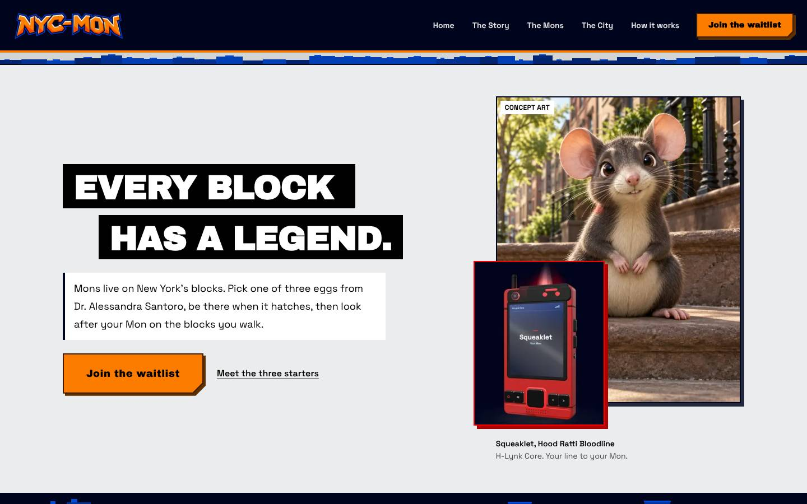
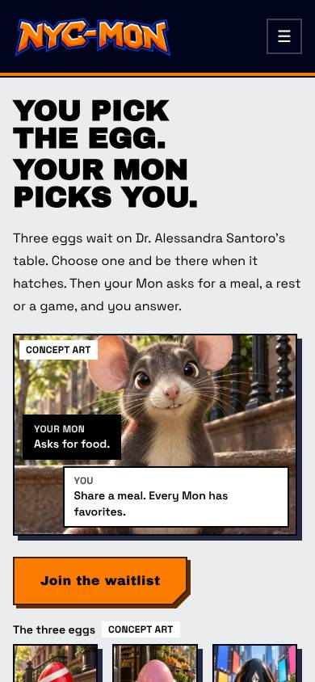
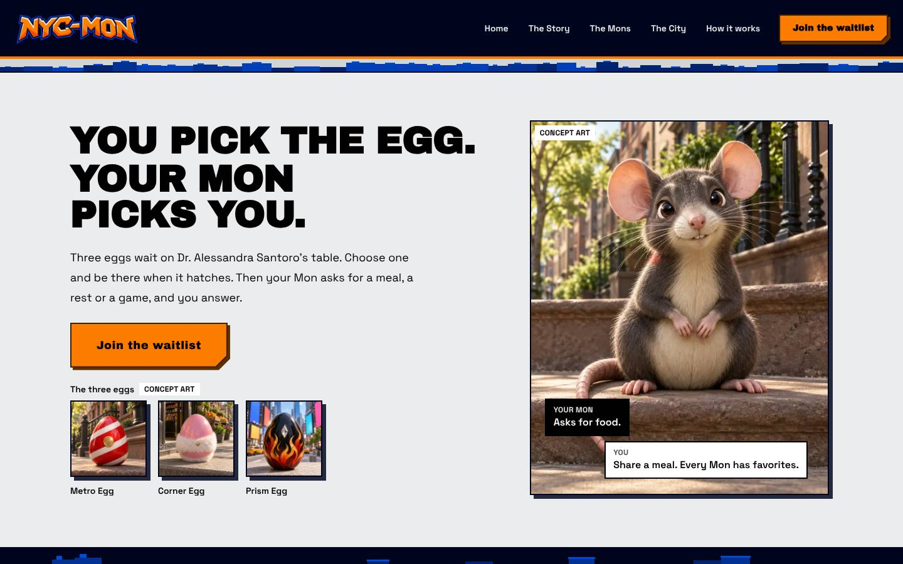
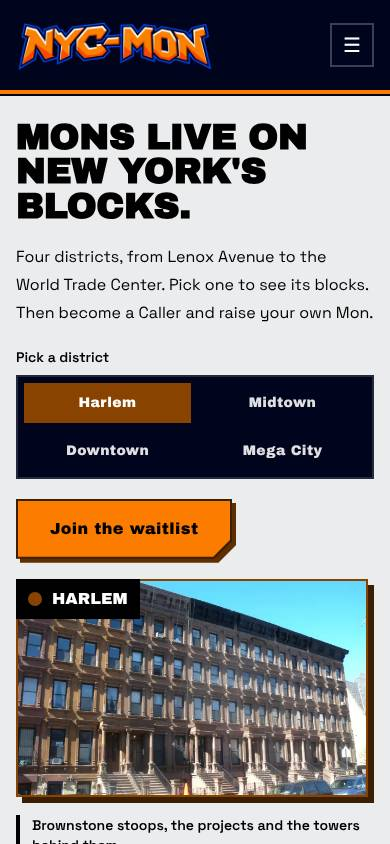
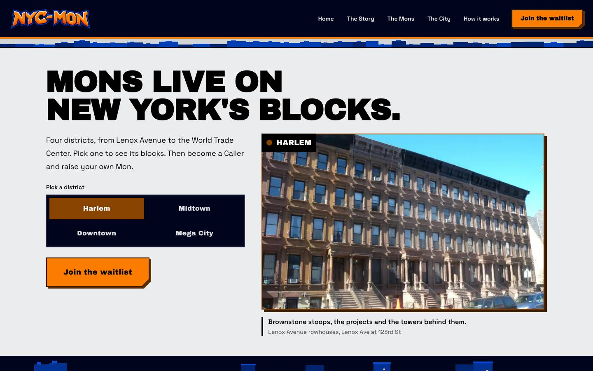

# Hero directions (WEB-02)

Owner: `headline-conversion-director` and `creative-director`. Status: **for creator review. Nothing here is live.**

Three complete hero treatments for W01, built side by side in a review-only route so the creator can compare them at real sizes. The public hero (`apps/web/components/home/HomeHero.tsx`), its copy (`apps/web/components/home/copy.ts`, `packages/spatial/homeCopy.ts`) and the art map (`art.ts`) are unchanged. Until the creator decides (see "Creator approval gate"), the public page keeps Direction A's approved headline, **Every block has a legend.**, in its current composition.

## Where to look

| What | Where |
|---|---|
| Review route | `/review/hero` (`apps/web/app/(site)/(review)/review/hero/page.tsx`). 404 unless `NYCMON_REVIEW_ROUTES=1`. `robots: { index: false, follow: false }`. Not in the nav, footer or `app/sitemap.ts` (`lib/seo.ts` lists routes explicitly). |
| Deep links | `/review/hero?direction=a`, `?direction=b`, `?direction=c` |
| Components | `apps/web/components/review/hero/` (`DirectionCanon.tsx`, `DirectionCompanion.tsx`, `DirectionCity.tsx`, `CityDistrictStage.tsx`, `HeroDirectionSwitcher.tsx`, `parts.tsx`) |
| Copy | `apps/web/components/review/hero/copy.ts`, linted by `copy.test.ts` (banned words, Callah, exclamation marks, Mon pronouns, sentence case, the route gate) |
| Captures | `docs/design/site/hero-directions/{a,b,c}-{390,1440}.jpg` (JPEG q70, 390×844 and 1440×900, light scheme, reduced motion, first view with the hero directly under the sticky site header, as on `/`) |

To run it locally without touching the served `.next`:

```sh
cd apps/web
NYCMON_REVIEW_ROUTES=1 NEXT_DIST_DIR=.next-review node scripts/next.mjs dev -p 3200
```

`next dev` with a custom `distDir` appends `.next-review/...` to `apps/web/tsconfig.json`'s `include`. Revert that line before committing.

### How the review page is built

- The page's only `h1` is "Hero directions (internal review)". A radio group ("Direction", the kit's `SegmentedControl`, arrow keys move and select) picks one direction. Only the picked direction is mounted, so the DOM never holds more than one hero headline.
- Each direction sits in a `section` named "Direction A, canon-first" (and so on), under a strip that prints its status: **Approved headline** for A, **Proposed, not approved canon copy** for B and C.
- Inside the review page each direction's headline is an `h2`. Every direction component takes `level` (default `1`), so the shipped hero renders it as the page `h1`.
- The route sits in a nested route group inside `(site)` so it shares the site's root layout, nav and 404. A separate `(review)` root layout would need its own 404 (`global-not-found`) and would force a full reload when leaving the page.
- Only existing primitives and tokens: `@acme/ui` (`Image`, `LinkButton variant="cta"`, `SegmentedControl`, `useInstanceStore`), `@acme/ui/html`, `@acme/ui/tw`, theme tokens (`concrete-100`, `signage-black`/`white`, `ink-950`, `orange-500` through the CTA, `display-*` sizes in Archivo Black, Space Grotesk body). No new library.
- All three share the same surface: daylit concrete (`bg-concrete-100`), no city canvas, no night navy (Decision #4). The surface is fixed to day colours so it reads the same with the OS in dark mode.

Measured first-view positions (from the captures; header is 94 px tall at 390 and 114 px at 1440):

| | Headline | Image proof in first view | CTA |
|---|---|---|---|
| A 390 | 120–229 | Squeaklet + H-Lynk, 435–617 | 699–759 (in view) |
| B 390 | 120–261 | Squeaklet + exchange, 415–661 | 689–749 (in view) |
| C 390 | 120–223 | District photo from 581 (partly in view) | 499–559 (in view) |
| A 1440 | 293–463 | Squeaklet 174–718, H-Lynk 468–758 | 631–703 |
| B 1440 | 196–371 | Squeaklet 194–788, eggs 641–759 | 515–587 |
| C 1440 | 164–300 | District photo 326–749 | 624–696 |

No direction scrolls sideways at 390 (`scrollWidth` 390).

---

## Direction A: canon-first (approved headline)

 

**H1:** Every block has a legend. (`HOME_COPY.tagline`, approved; the component throws if its line breaks stop spelling it)

**Subhead:** Mons live on New York's blocks. Pick one of three eggs from Dr. Alessandra Santoro, be there when it hatches, then look after your Mon on the blocks you walk.

This keeps the approved support line's three steps (`W01_COPY.hero.body`) and puts one sentence in front of them. That sentence says what a Mon is and where it lives, which the slogan alone does not: the audit scored "What is NYC-MON?" only *Inferable* (`PREMIUM_SITE_AUDIT.md` §2). It is taken from the approved site intro (`HOME_COPY.intro`).

**CTA:** Join the waitlist (`WAITLIST_CTA`, → `/get`). Secondary text link: Meet the three starters (→ `/mons`).

**Hero art and rationale**

- `packages/assets/creatures/squeaklet.webp`, through `art('starter.1')`. Squeaklet (#002, Hood Ratti Bloodline) sits on a sunny Harlem stoop, which proves the headline: here is a legend on a real block. Tagged **Concept art** on the image (PS-028 stand-in).
- `apps/web/public/home/h-lynk-core-v2.png`, the red H-Lynk Core render (Decision #16, PS-002). It is stamped over the poster's lower-left corner from `lg` and sits beside it on a phone, in an `apple` (red) keyline frame. Its screen already reads "Squeaklet, Your Mon", so the two pictures tell one story: this Mon, and your line to it. The caption uses the approved H-Lynk lede: "H-Lynk Core. Your line to your Mon."
- Signage plates for the headline, as on the live hero, on concrete instead of over the night city.

**Mobile layout (390):** headline as two black plates ("Every block" / "has a legend.", the second indented) → support line on a white plate with an ink rule → art row, Squeaklet (3/5 width) beside the H-Lynk (2/5), 192 px tall → captions → CTA → secondary link. Everything through the CTA is in the first view.

**Desktop layout (1440):** 12-column grid. Copy in columns 1–7, vertically centred on the art; art in columns 8–12 (Squeaklet 4:5, H-Lynk overlapping its corner).

**Screen-reader reading order:** heading "Every block has a legend." → support paragraph → figure: Squeaklet image (alt from `@acme/assets/creatures`), "Concept art", H-Lynk image ("The H-Lynk Core, a matte red handheld with a black scanner head along the top, its screen reading Squeaklet, your Mon"), caption "Squeaklet, Hood Ratti Bloodline" and "H-Lynk Core. Your line to your Mon." → link "Join the waitlist" → link "Meet the three starters".

**5-second hypothesis:** after five seconds on the phone view, a first-time visitor can say that Mons are creatures that live in New York (the stoop picture plus "Mons live on New York's blocks") and that you get one and look after it (the red handheld showing "Your Mon"). Pass bar, from audit H1: 4 of 5 get "creatures in New York", 3 of 5 get "you look after one". Risk: the slogan is abstract, so people may read the image before the headline and call it "a cute rat game".

**Tradeoffs**

- Strongest canon fit and no copy approval needed for the H1. The support line is a one-sentence addition to approved copy and does need a nod.
- The H-Lynk render has a night-navy backdrop baked in (rendered on `ink-950`, PS-017), so it reads as a dark product plate on a daylit page. A daylit capture means re-rendering `device-scene.ts`.
- Drops the district picker and the city canvas from the hero. The four districts move to the signage board below, which already lists them (PS-014).
- Two images compete for attention at 390. The H-Lynk is small there (139 px wide) and the scanner head is hard to read.
- LCP becomes the Squeaklet WebP (eager, priority) instead of the Chrysler photo.

**Canon notes:** Decision #5 (three eggs, Santoro presents), #9 (Squeaklet #002), #11 ("Hood Ratti Bloodline"), #16 and PS-002 (matte red body, black scanner head), Decision #8 (the H-Lynk never owns the bond; the caption says "your line to", not "controls"). No pronoun for a Mon (PS-005). The alt says "handheld", never "device" (Law 9). See "Open canon question" below about showing a Baby first.

---

## Direction B: companion-first (proposed, not approved canon copy)

 

**H1 (proposed):** You pick the egg. Your Mon picks you.

**Subhead (proposed):** Three eggs wait on Dr. Alessandra Santoro's table. Choose one and be there when it hatches. Then your Mon asks for a meal, a rest or a game, and you answer.

**CTA:** Join the waitlist.

**Why this copy:** the audit scored "What do I do with a Mon?" as *Missing* above the fold (§2), and the message ladder (§9) lists "the Mon is a relationship (... it chooses you at the hatch, Decision #14)" as supporting proof. This headline makes that proof the promise and gives the visitor two verbs, pick and answer. "Your Mon picks you" is a plain restatement of "The Mon chooses too" (`V11 ¶47`) landing at the hatch, and it is never a rejection (Decision #14). "Three eggs ... on Dr. Santoro's table" mirrors the approved starters title. "A meal, a rest or a game" are the approved CARE verbs (Feed, Rest, Play).

Alternatives considered for B's H1 (all unapproved):

| Option | Copy | Why not first |
|---|---|---|
| B1 (built) | You pick the egg. Your Mon picks you. | Call and response; both sides of the bond; two verbs |
| B2 | Pick an egg. Meet your Mon. | Clear action but loses the "Mon chooses too" idea |
| B3 | Somebody on your block is about to hatch. | From audit §9; strong hook, says less about what you do |

**Hero art and rationale**

- `packages/assets/creatures/squeaklet.webp` (concept art, tagged), cropped high so the face leads.
- The exchange over the picture, taken verbatim from the approved CARE copy (`W01_COPY.care.items[0]`): a black plate "Your Mon: Asks for food." and a white plate "You: Share a meal. Every Mon has favorites." This is the relationship, shown as an exchange instead of a meter.
- The three eggs, `packages/assets/creatures/metro-egg.webp`, `corner-egg.webp`, `prism-egg.webp` (PS-028 bundled them "for the egg-choice screen (M08) or a later section"), as a labelled row under the CTA, with names from `@acme/content`. This is the choice the headline promises.
- Plain black display type on concrete, no plates, so the two sentences read as call and response.

**Mobile layout (390):** headline (4 lines) → support line → Squeaklet with the exchange laid over its lower half (256 px) → CTA (in the first view at 689–749) → "The three eggs" row, just below the first view.

**Desktop layout (1440):** copy, CTA and the egg row in columns 1–7; Squeaklet with the exchange in columns 8–12.

**Screen-reader reading order:** heading "You pick the egg. Your Mon picks you." → support paragraph → figure: Squeaklet image (alt), "Concept art", caption "Your Mon, Asks for food. You, Share a meal. Every Mon has favorites." → link "Join the waitlist" → "The three eggs", "Concept art" → list, 3 items: Metro Egg, Corner Egg, Prism Egg (egg pictures are `alt=""` because the visible name labels them).

**5-second hypothesis:** visitors can say what they would do (pick an egg, look after a Mon that asks for things) more often than with A. Pass bar: 3 of 5 name a care action or the choice unprompted (audit H1 (b), H2). Risk: nothing in the first view says New York at 390 except the stoop in the picture, so "Mons are creatures in New York" may drop below 4 of 5.

**Tradeoffs**

- Best answer to "what do I do?" and the most emotional. Matches the Grail "one character fills the frame, chips next to the CTA" pattern (Mobbin addendum card 1).
- New headline and support line need creator approval as canon copy.
- No H-Lynk above the fold. That is deliberate (the bond is never the H-Lynk's, Decision #8), but audit §2 also scored "What is H-Lynk?" *Missing*.
- The egg row is a second set of images. The eggs are not interactive (the choice happens in the app, M08), so they must never look like buttons. They have no hover state and no link.
- Headline is long for a phone (4 lines at 36 px).

**Canon notes:** Decisions #5, #9, #14. "Caller" does not appear, and "your Mon" is the allowed possessive (COPY_DECK "Caller and Callah"). No pronoun for a Mon. "Picks you" must never become "might pick you" or "if your Mon likes you", which would imply rejection (Decision #14).

---

## Direction C: city-first (proposed, not approved canon copy)

 

**H1 (proposed as a headline):** Mons live on New York's blocks.

This is the first sentence of the approved site intro (`HOME_COPY.intro`), promoted to H1. The words are approved; using them as the headline is not.

**Subhead (proposed):** Four districts, from Lenox Avenue to the World Trade Center. Pick one to see its blocks. Then become a Caller and raise your own Mon.

"Four districts, from Lenox Avenue to the World Trade Center." is the approved World line (`W01_COPY.world.body2`); "become a Caller and raise your own Mon" is from the approved intro.

**CTA:** Join the waitlist.

**Hero art and rationale**

- The district picker is the first control, at full column width, 2×2, with the label "Pick a district" (same as the live hero). It is the kit's `SegmentedControl`, a radio group (PS-012). Its state is local to the review: it does not write the site-wide district store.
- It swaps one bundled, licensed daylit photograph per district (`@acme/assets/photos`): Harlem `harlem-lenox-rowhouses` (default), Midtown `midtown-chrysler-spire`, Downtown `downtown-one-wtc`, Mega City `megacity-brooklyn-bridge-night`. The frame keyline takes the district tone; a signage plate on the corner names the district with its disc; the caption gives the district line from `DISTRICT_COPY` and the photo's real place.
- Full-width station-sign headline from `lg`. The type is the picker, as in Craft Agency's stacked city names (Mobbin addendum card 10).
- No creature above the fold, on purpose: this direction tests whether the city alone carries the first five seconds.

**Mobile layout (390):** headline (3 lines) → support line → picker (2×2) → CTA (499–559) → photo with district plate, partly in the first view → caption.

**Desktop layout (1440):** headline across all 12 columns; support line, picker and CTA in columns 1–5; photo 16:10 in columns 6–12.

**Screen-reader reading order:** heading "Mons live on New York's blocks." → support paragraph → "Pick a district" → radio group, 4 radios (Harlem, Midtown, Downtown, Mega City; Harlem checked) → link "Join the waitlist" → figure: district photo (alt from `@acme/assets/photos`), "Harlem", caption with the district line and "Lenox Avenue rowhouses, Lenox Ave at 123rd St". Picking a district does not announce the new caption; the radio's own "checked" announcement says what changed. The photo is not in a live region, which would make every arrow press chatty.

**5-second hypothesis:** visitors can say the game happens in New York and name or point to a district more often than with A or B. Pass bar: 4 of 5 say "New York" unprompted. Risk, from audit §2: without a creature, "What is NYC-MON?" may fall to *Missing*. The guess is that at least 2 of 5 will call it a city guide or a travel app.

**Tradeoffs**

- Clearest "Why NYC?". The picker is the most interactive hero and the most fun to touch.
- No Mon and no H-Lynk in the first view repeats the audit's main finding (W3, "no creature anywhere").
- Four LCP candidates. Only the picked photo is in the DOM, but each pick loads a new 1200×800 WebP. PS-026 rejected per-district hero photos for this reason and for layout-shift risk; the review keeps the box fixed at 16:10 so there is no shift.
- Mega City has only night photographs. A night photo in a daylit hero breaks the daylight rule for that one pick.
- Midtown's tone face is the same orange as the CTA, so when Midtown is picked the selected radio competes with the CTA (visible in the Midtown check during review).
- Bundled photos vary in quality. The Harlem rowhouses shot is soft and slightly tilted next to the generated creature art.

**Canon notes:** the four districts and their lines are `DISTRICT_COPY`. Mega City has no cross streets because canon doesn't place it on a map (PS-006). "Caller" is used correctly in ui copy. "Raise your own Mon" is approved intro wording ("your own" in the partner sense, COPY_DECK).

---

## Design critique (applied while iterating)

Following `design:design-critique` on the captures:

| Finding | Severity | What changed |
|---|---|---|
| A at 1440: "Has a legend." wrapped inside its plate at `display-2xl` | Moderate | Capped at `display-xl` so each plate holds one line |
| Captions ran together inline ("Bloodline" + "H-Lynk Core") | Moderate | Captions are flex columns, one line each |
| B at 1440: the egg row fell below 900 px | Moderate | Copy column widened to 7, headline one step smaller; eggs end at 759 |
| B at 390: the "You" plate hung below the image and pushed the CTA to the bottom edge | Moderate | The exchange now sits over the image; CTA moved up to 689–749 |
| B: the orange rule under "Your Mon picks you" competed with the orange CTA | Minor | Removed. Orange stays for the CTA and the hatch (Decision #7) |
| C at 390: CTA at 883, below the 844 px view | Critical | CTA moved before the photo in DOM and on screen; the district name became a plate on the photo; now 499–559 |
| C at 1440: picker wrapped 3 + 1 in 5 columns | Moderate | 2×2 at every width, taller segments from `md` |
| C: Midtown's orange selected radio vs the orange CTA | Minor | Not changed (kit tone). Logged as a tradeoff |

Checked by keyboard (Playwright): arrow keys in the "Direction" group switch A → B → C and update `?direction=`; in C, the arrow key moves Harlem → Midtown, focus stays on the radio and the photo swaps to the Chrysler Building. No console errors or warnings. The robots meta reads `noindex, nofollow`.

---

## Recommendation

**Make Direction A the default, with its new image proof. Run B against it in the five-second test before changing the headline. Do not pursue C as a hero; move its picker idea into the signage and World sections.**

Reasons, from the sources:

1. **A answers the audit's gaps without new canon copy.** Audit §2 scored the current hero *Inferable* on "What is NYC-MON?" because there is "no creature above the fold", and *Missing* on "What is H-Lynk?". A puts the starter Baby and the red H-Lynk Core in the first view at both widths, and keeps the headline the audit already recommended keeping (§9: "keep H1 (1), already owned, with support line (1)").
2. **B is the best answer to the remaining gap, "What do I do with a Mon?" (§2: *Missing*), but it is unapproved copy.** It is also the direction most likely to move audit H2 (teens care because of the starters and the choice). That is a hypothesis to test, not a reason to ship unapproved canon copy. If B wins the five-second test, its exchange plate can move into A's art first, which needs no headline change.
3. **C repeats the audit's main finding.** W3, rated High, was "no creature anywhere". C puts no creature in the first view, and it brings back the four-photo LCP and picker-caption issues that PS-026 already closed. Its strength, the city as a picker, belongs below the hero, where the signage board (PS-014) and World (PS-015) already carry the districts.
4. **Daylight and the rendering rules hold for A and B.** Both are server HTML apart from the review switcher, with one eager image and fixed boxes (PS-008, PS-013). C needs a client island for every pick.

---

## Open canon question (creator)

COPY_DECK's glossary says the Babies are "Never shown before the hatch" (P3). PS-028 and PS-029 later allowed Baby forms on public pages, and the live STARTERS section shows all three. A and B move a Baby into the first view of the site. That is consistent with PS-028, but it is the most prominent use yet, so it should be an explicit yes.

---

## Creator approval gate

Nothing below changes the public page until Mike signs off. Until then **the public default stays Direction A's approved headline, "Every block has a legend.", in the current composition** (`HomeHero.tsx`, untouched).

| # | Decision | Options | Default if no answer |
|---|---|---|---|
| G1 | Which headline ships | A (approved) / B / C | A |
| G2 | A's new first sentence, "Mons live on New York's blocks." in front of the approved support line | approve / keep the current body | current body |
| G3 | Hero art: Squeaklet concept art + H-Lynk Core render in place of the Chrysler photo and city canvas | approve / keep the current art | current art |
| G4 | A Baby in the first view (open canon question above) | yes / no | no change |
| G5 | If B: headline and support line become canon copy (COPY_DECK, `W01_COPY.hero`) | approve as written / edit | not adopted |
| G6 | If C: same as G5, plus accepting a night photo for Mega City | approve / edit | not adopted |

When G1–G4 are answered, the change is an edit to `HomeHero.tsx`, `copy.ts` and `art.ts` that reuses `DirectionCanon`'s composition, followed by the usual QA lane (Lighthouse LCP and CLS, axe, captures). The review route and `components/review/hero/` can then be deleted.

---

## Moderated five-second test plan

**Status: not yet run. No participants recruited, no results.**

**Question:** which hero gives first-time visitors the right answer to "what is this, where is it, and what would I do?" after five seconds?

**Method:** moderated, in person, on a phone browser at 390×844 (the captures' size), following the ground rules in `docs/design/research/HALLWAY_TESTS.md` (rounds of five; report counts like "3 of 5", never percentages; guardian written consent for minors; screen-only recording). Between-subjects: each participant sees one direction, cold, so no direction primes another. Rotate the order of assignment across sessions (A, B, C, A, B, ...).

**Build:** the review route on a recorded SHA, opened at `/review/hero?direction=<x>`, scrolled so the hero sits directly under the site header, as in the captures, so the review strip and picker are out of view. If that is fiddly on the test phone, show the matching `-390.jpg` capture full screen instead. Write the SHA and direction on every notes sheet. A finding from an unknown build is not a finding.

**Participants:** 15 (five per direction): per direction, two teens 13–17 with guardian consent, two adults who have kept a virtual pet or care game, one parent of a 9–15-year-old. No under-13s. Exclude anyone who has seen NYC-MON art or builds.

**Script (per participant, about 5 minutes)**

1. "I'll show you a web page for five seconds, then hide it and ask a few questions. There are no wrong answers."
2. Show the hero for five seconds, then hide it.
3. Ask, in order, without hints:
   - "What is this?" (codes: creatures or a game in New York / pet or care game / city guide or travel / other)
   - "Where does it happen?" (New York or a district named / other / don't know)
   - "What would you do in it?" (pick an egg or look after a Mon / play a game, unspecified / don't know)
   - "What could you do on this page right now?" (join a waitlist / download / don't know)
   - "What was the red thing?" (only if A was shown: handheld connected to the Mon / phone / app / toy / didn't see)
   - "What words do you remember?"
4. Language check: log every word used for the player, the Mon and the H-Lynk ("owner", "pet", "the phone thing" are data, COPY_DECK Law 9).

**Pass bars (from audit H1, applied to each direction)**

| Measure | Pass |
|---|---|
| Creatures or a game in New York | 4 of 5 |
| Names a care action or the egg choice | 3 of 5 |
| Waitlist, not "download it now" | 4 of 5, and no more than 1 of 5 says "download" |
| A only: H-Lynk read as a handheld tied to the Mon | 3 of 5 |

**Decision rule:** if B passes "names a care action" by at least 2 more participants than A and does not fail "creatures in New York", bring B (or B's exchange plate inside A's art) to the creator for G1/G5. If no direction beats A, ship A (G2–G4) and close this review. C is only reconsidered if it is the only direction to pass "Where does it happen?".

**Results**

| Direction | Creatures in NYC | Care action or choice | Waitlist | H-Lynk (A) | Notes |
|---|---|---|---|---|---|
| A | not yet run | not yet run | not yet run | not yet run | |
| B | not yet run | not yet run | not yet run | n/a | |
| C | not yet run | not yet run | not yet run | n/a | |

Synthesize within 48 hours into `docs/design/research/rounds/<date>-hero-directions.md`, per `HALLWAY_TESTS.md`.
